# System Diagrams for Smart Car Rental System

## 1. Detailed Class Diagram
This diagram acts as the blueprint of the system, showing all the classes, their attributes (with data types), their methods (with return types), and how they relate to one another.

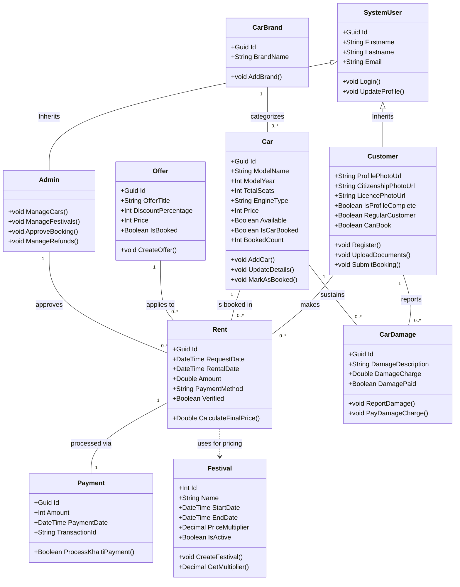

### Method Return Types Explained:
*   **void** — The method performs an action but does not return any data back. For example, `void AddCar()` just saves the car to the database and does not give back any value.
*   **Double** — The method returns a decimal number. For example, `Double CalculateFinalPrice()` calculates and returns the final rental amount (like 4200.00).
*   **Decimal** — Similar to Double but more precise for money. `Decimal GetMultiplier()` returns the festival price multiplier (like 1.2).
*   **Boolean** — The method returns either `true` or `false`. For example, `Boolean ProcessKhaltiPayment()` returns `true` if the payment was successful and `false` if it failed.

---

## 2. Detailed Object Diagram
The Object Diagram represents a "snapshot" of the system at a specific second in time. In this scenario: Customer "Ram" is booking a "Toyota Corolla" during the "Dashain Festival". The festival multiplier increases the price, and the Admin approves the booking.

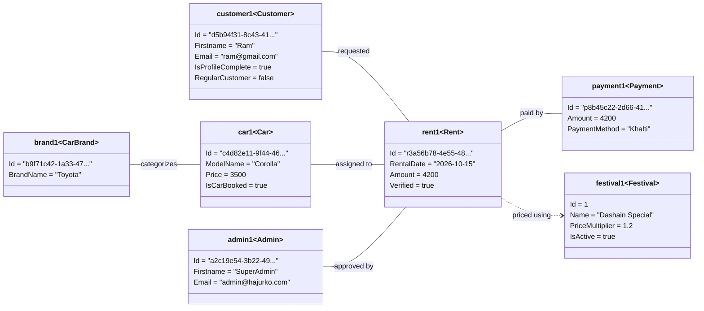

### Arrow Types Summary:
*   **Empty Triangle Arrow (◁——)** = Inheritance. Means "Is A" (Customer is a SystemUser).
*   **Solid Line with Numbers** = Association. Shows database relationships (1-to-many).
*   **Dashed Arrow (- - ->)** = Dependency. Means "Uses" (Rent uses Festival for pricing).
*   **Plain Solid Line (in Object Diagram)** = Instance Link. Shows data connected right now.

---

## 3. Final State Diagram
This state diagram covers the rental request lifecycle. `Login` is a precondition in the app, so the main flow focuses on profile status, payment, approval, and return.

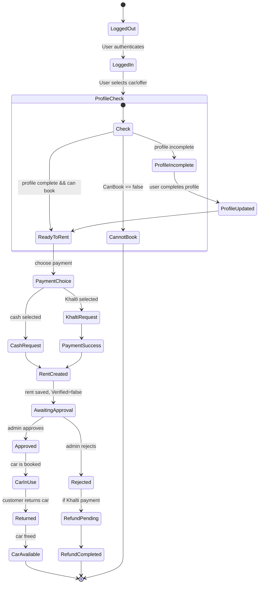

## 4. Final Sequence Diagram
This smaller, correct sequence diagram shows the real booking flow in the code:

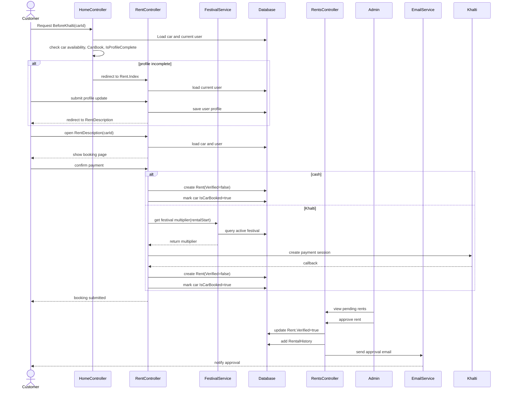

## 4. Full Sequence Diagram (admin verification added)
This is the complete booking flow including the admin verification checks performed before approval.

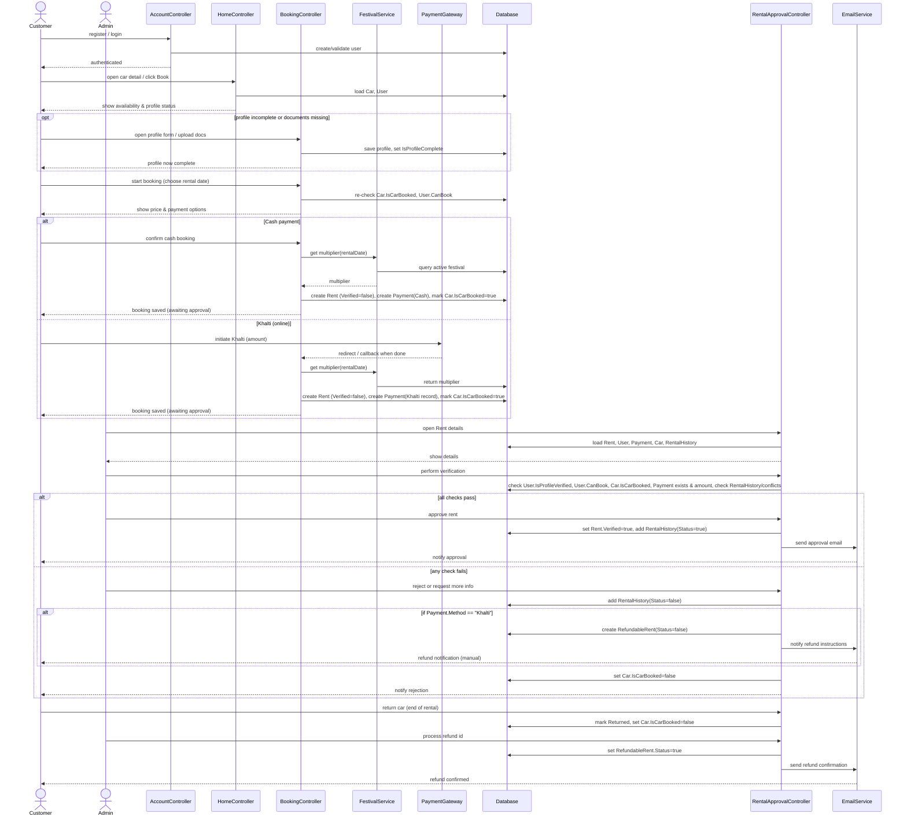

## 5. Compact Sequence Diagram
When the detailed flow is too large, use this smaller version for a cleaner overview.

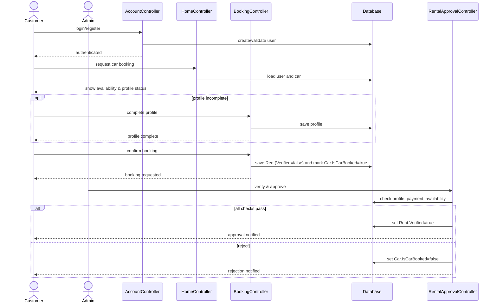

## 6. Compact State Diagram
A smaller state view with the same lifecycle steps.

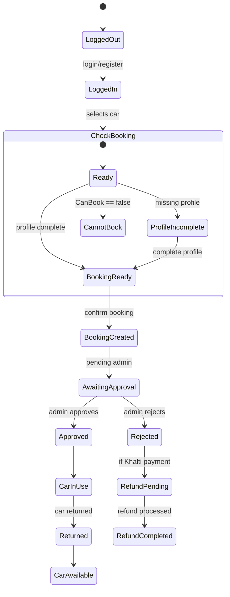

## 7. Activity Diagram
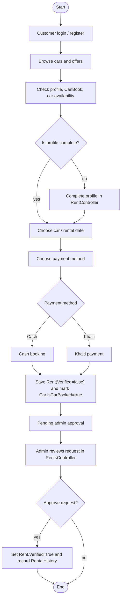

## 8. Component Diagram
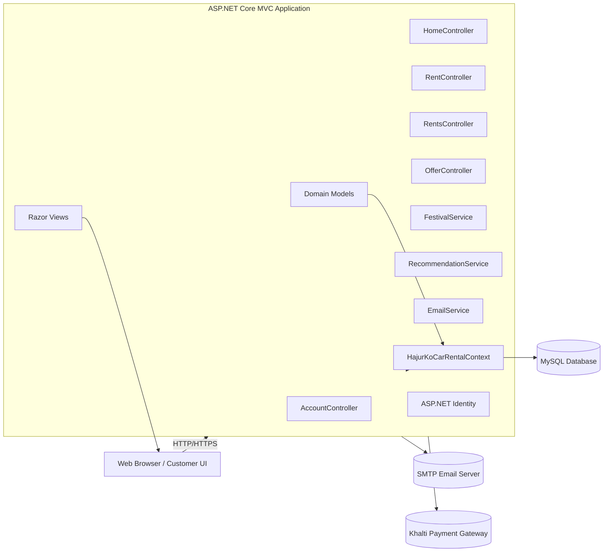

## 9. Deployment Diagram
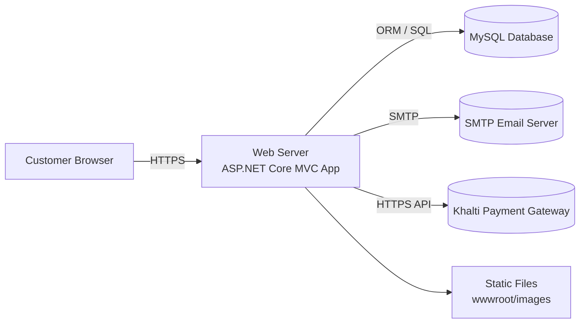

## 10. Refinement of Diagrams for Analysis
These diagrams are the refined analysis models for the system. They use the actual entities, lifecycle states, controller interactions, and workflow decisions from the HajurKoCarRental application.

### 10.1 Refined Class Diagram
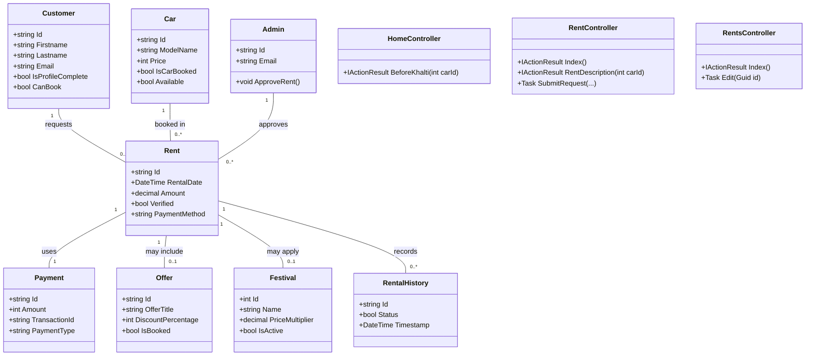

### 10.2 Refined Object Diagram
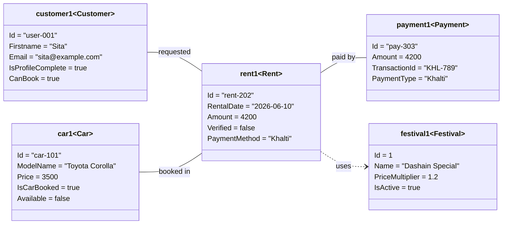

### 10.3 Refined State Diagram
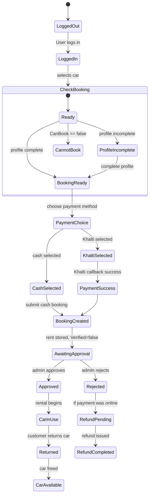

### 10.4 Refined Sequence Diagram
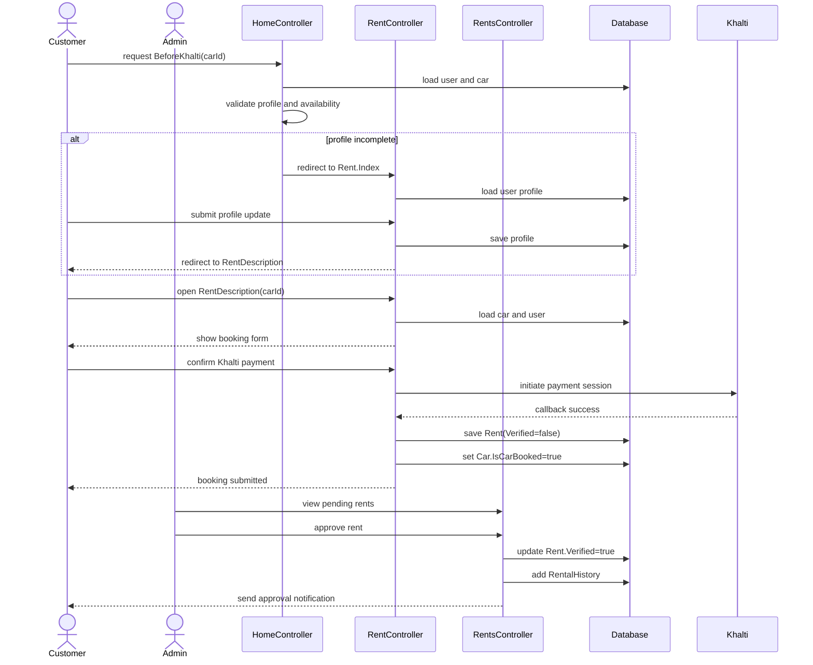

### 10.5 Refined Activity Diagram
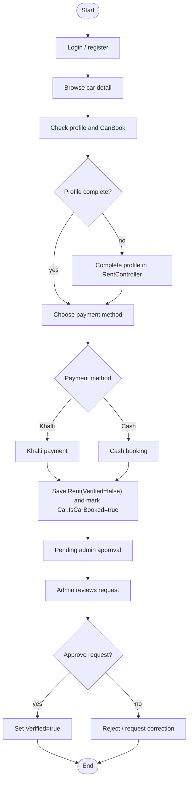

